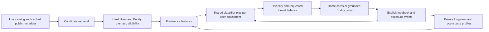

# Adaptive personalised classification and ranking

Research completed 2026-11-17. **Status: proposed design; no new model trained, deployed or enabled by this report.** Sources are primary papers, official documentation and the existing experiment records. Suggested formulas and staging decisions are Distran design recommendations, not measured results.

## Recommendation

Combine the existing systems through a shared feature-based preference classifier and ranker. Begin with a small, regularised online logistic model that has a shared prior and a private per-user adjustment. Keep live catalog discovery, factual constraints and conversation as separate responsibilities. Add collaborative signals and contextual-bandit exploration only after interaction data and evaluation support them.

The SVD encoder, Ridge score regressors, BPR factors and hosted OpenRouter models have different feature spaces, training targets and parameter shapes. Their useful combination is **feature/score fusion**, rather than averaging their parameter files. For example, semantic affinity and studio affinity can feed a preference classifier; aggregate movie-score predictions cannot become personal movie ratings through a change of scale.

## What exists in this repository

| Component | Evidence in the current app | Recommended use |
|---|---|---|
| Shared content encoder | Kaggle TF-IDF/SVD trained on 32,952 metadata documents; v3 serving artifacts use canonical provider IDs | Reuse as the initial semantic feature extractor and baseline |
| Home taste profile | `recommendations.ts` weights favourites, high ratings and dislikes; coefficients and MMR balance are fixed | Replace fixed channel importance with an evaluated adaptive layer; extend candidate/vector coverage beyond the bundled works |
| Buddy discovery | Live TMDB/IGDB title, taxonomy, similar-work and director/studio discovery; dynamic text projection | Reuse candidate generation and canonical identities |
| Buddy thematic classifier | Free Decider judgments; fixed mix of 0.75 thematic score, 0.15 retrieval and 0.10 rating-count support | Keep as request-relevance evidence; its score is not a personal preference probability |
| Buddy conversation | Free Nemotron search planning and explanations from real records | Retain for language and grounded explanations, not private taste-weight updates |
| Three metadata regressors | Heldout aggregate-score prediction results, with no user interactions | Keep as offline baselines; test any aggregate-quality contribution separately |
| Amazon BPR | Validation selected collaborative weight **0.0**; existing report does not support promotion | Keep disabled in the app; retrain/evaluate a mapped hybrid before using collaborative scores |

The current account store includes favourites, ratings/statuses, lists and followed creators, but has no recommendation-impression ledger or logged selection probabilities. `Log.date` is not a dedicated immutable recommendation-event timestamp. The demo accounts contain seeded tastes; local signup clears favourites/lists but still inherits some starter profile fields. Training must distinguish explicit user actions, demo fixtures and defaults. No private user-store contents were inspected for this research.

Implementation evidence: [Home ranker](../../apps/desktop/src/lib/recommendations.ts), [account schema](../../apps/desktop/src/lib/store.ts), [Buddy orchestration](../../backend/app/buddy.py), [Kaggle results](KAGGLE_TRAINING_RESULTS.md), [Amazon results](TRAINING_RESULTS.md). Existing successful metadata regression is not evidence that personalised recommendations will improve.

## Proposed system



For Home, estimate personal fit and diversify the resulting list. For Buddy, establish eligibility for the explicit request first, then personalise **within eligible works**. A taste for fantasy must not make a cyberpunk request return unrelated fantasy. Medium, seen exclusions, verified duration and other implemented factual constraints remain deterministic; learned weights cannot relax them. Session requests such as “games only” are not permanent taste updates.

The shared classifier can be used on different pages, while Home and Buddy retain their distinct labels, explanations and Buddy glow. Their objectives differ: Home discovers likely interests; Buddy fulfils the current request.

## How the weights change

There are two useful kinds of adaptation:

1. **Taste representation:** weighted interests in individual themes, genres, directors and studios, plus separate positive/negative semantic profiles. A new rating updates what the user appears to like.
2. **Signal importance:** how strongly semantic similarity, creator affinity, genre affinity, recent interests and other channels should influence this user's results. Feedback updates how the classifier combines them.

Start with roughly 12–30 bounded numeric features, rather than a large neural model per account. Candidate features can include long-term semantic affinity, recent semantic affinity, negative affinity, genre/theme affinity, director or studio affinity, format interest, novelty, repeated-exposure penalty, metadata completeness and a small aggregate-quality feature. Keep missingness flags. Match creators by provider IDs; movie/TV primary creators are directors and game primary creators are developer studios. Supporting credits remain separately typed. Provider taxonomies need explicit cross-format concept mapping; unrelated numeric genre IDs must not be conflated.

One proposed preference head is:

```text
p(u, i, c) = sigmoid(b + b_u + (theta_shared + delta_u) · x(u, i, c))
```

`x` contains the personalised features; `c` identifies the surface and session context. `delta_u` is a small private per-user coefficient vector, initialised at zero and regularised towards zero. Thus new users inherit the prior, and sparse users do not immediately overfit. Before fitting and calibration, the output is only a ranking score, not an “80% chance you will love this” claim.

For a labelled event, an illustrative online update is:

```text
delta_u <- delta_u + learning_rate *
           (confidence * (label - prediction) * x - regularisation * delta_u)
```

The intercept needs its own bounded update. Clip feature/update norms, deduplicate events and bound each event's contribution. Update against the feature snapshot and prediction recorded at recommendation time. These choices prevent a replayed save or a single extreme event from changing the whole profile. A shared prior becomes learned only after fitting on suitable data; hand-picked initial coefficients must remain labelled as heuristics.

Maintain long-term and recent profiles separately. Recency weighting can use `2^(-age / half_life)` on correctly timestamped events, with a floor for durable explicit interests. Validate half-lives rather than assuming one fixed horizon suits films, TV and games. Recompute/replay affected local events when feedback is edited or deleted. An encoder or feature-schema change requires a compatible migration or profile rebuild; coefficients from one feature space cannot be silently reused in another.

This is practical incremental learning: River documents individual-example updates, weighted observations and probability prediction for logistic regression. A production browser implementation could export plain JSON coefficients and implement the same small update in TypeScript, with numerical-parity checks; River itself would remain a Python experiment/reference dependency. [River logistic regression](https://riverml.xyz/latest/api/linear-model/LogisticRegression/).

## Labels and events we need

Avoid treating every interaction as the same training target.

| Observation | Initial handling |
|---|---|
| Explicit “more like this” / “less like this” | Positive/negative taste feedback, with an optional reason |
| High/low rating | Taste evidence; use an explicit, versioned threshold policy; neutral/unrated values stay unknown |
| Favourite | Positive taste evidence; exclude seeded/default/demo favourites from training |
| Creator follow | Creator-interest evidence; distinguish user follows from starter defaults |
| Save to a list | Separate intent signal; a saved recommendation is not proof of enjoyment |
| Card click | Weak engagement signal, not an explicit preference label |
| “Already seen” | Exclusion correction, not dislike |
| Dropped status | Ambiguous unless accompanied by a dislike/reason; time constraints can cause dropping |
| No click or no rating | Unknown taste; unshown works are not negatives |
| Buddy preselected cards saved together | Batch intent evidence; do not count each card as an independently chosen positive taste label |

Start with an explicit-preference head. Add a separate save/engagement head once its target, attribution window and exposure data are defined. Combining multiple heads later requires a deliberate product utility function; maximising clicks alone does not establish enjoyment.

Record recommendation ID, pseudonymous local account key, event ID, event type, surface, real work ID, served rank, shown-at and acted-at timestamps, encoder/policy/feature versions, served feature snapshot, and the event's provenance. Record the eligible candidate set or a reproducible candidate snapshot reference. Visibility needs an explicit impression definition; merely constructing a card does not prove the user saw it. If choices are randomised, log the **actual selection probability**, including conditional slot probabilities where applicable—not the classifier score.

Add small feedback controls to Home and Buddy cards, a reason selector for negative feedback, and a preference reset/rebuild control. Keep existing ordinary/Buddy source distinctions. Explanations should report real feature contributions or factual source connections; a coefficient is predictive evidence, not proof that a particular studio caused enjoyment.

## Approaches considered

| Approach | Strength | Decision for Distran |
|---|---|---|
| Online logistic classifier with a shared prior and local user adjustment | Small, understandable, immediately updateable from explicit feedback; easy JSON serving | **Recommended first implementation** |
| LightFM hybrid factorisation | Learns from user/item interactions and metadata; useful cold-start baseline | Evaluate after canonical interaction coverage exists; its incremental API does not remove identity/schema requirements |
| CatBoost learning-to-rank | Models nonlinear feature interactions and ranks grouped candidate sets | Compare offline when there are enough meaningful recommendation groups; ordinarily retrained in batches |
| Two-tower / multi-task neural recommender | Can share representations across retrieval and preference tasks | Later experiment if scale and measured learning curves justify complexity |
| Contextual bandit | Can adapt an exploration policy from feedback | Defer until there are logged exposures, real propensities and reward/evaluation design |
| Parameter averaging across our current artifacts | Incompatible architectures, labels and dimensions | Use feature/score fusion instead |

LightFM combines metadata features with learned collaborative representations, while CatBoost provides ranking objectives. TensorFlow's multi-task example demonstrates shared retrieval/rating representations with weighted losses; task-loss weights are distinct from per-user feature coefficients. These capabilities motivate experiments, not a guarantee of gains in Distran. [LightFM paper](https://arxiv.org/abs/1507.08439), [LightFM implementation](https://making.lyst.com/lightfm/docs/lightfm.html), [CatBoost ranking objectives](https://catboost.ai/docs/en/concepts/loss-functions-ranking), [TensorFlow multi-task example](https://www.tensorflow.org/recommenders/examples/multitask).

For semantic features, benchmark the existing SVD against an open encoder such as `intfloat/e5-small-v2` before replacing it. Its model card specifies MIT licensing, 384-dimensional embeddings and retrieval prefixes. Use model-specific query/passage formatting, re-embed the catalog and measure latency/quality locally. Pretrained benchmark performance does not establish performance on our cross-format catalog or themes. [Official E5 model card](https://huggingface.co/intfloat/e5-small-v2).

## Bandits and evaluation

Updating a classifier's weights after ratings is not itself a contextual bandit. A bandit also chooses what to expose to learn about uncertain preferences. Once a stable ranker exists, a small optional exploration slot among eligible works or a choice between a few ranking policies is a more manageable first experiment than a huge unconstrained action space. Keep hard constraints and explicit Buddy relevance intact. A browser refresh is not a new independent preference signal.

LinUCB is an established contextual-bandit approach, and Vowpal Wabbit provides concrete training/logging examples. Offline policy evaluation needs exposure support and known logging probabilities; existing favourites and ratings cannot reconstruct them. Doubly robust estimators combine a reward model with logging-policy information, but do not solve zero support or incorrect propensities. Slates and position effects require suitable estimators, not naive item-wise reuse. [LinUCB paper](https://arxiv.org/abs/1003.0146), [VW tutorial](https://vowpalwabbit.org/docs/vowpal_wabbit/python/latest/tutorials/python_Contextual_bandits_and_Vowpal_Wabbit.html), [doubly robust evaluation paper](https://arxiv.org/abs/1103.4601).

Evaluation should precede any “advanced” or improved-quality claim:

- Compare current fixed weights, content-only profiles, adaptive linear profiles, then optional LightFM/CatBoost candidates. Use the same available candidate pools for ranker comparisons; measure retrieval coverage separately.
- Use chronological train/validation/test boundaries, as-of metadata/features and matured feedback windows. Replay each online event by predicting **before** learning its label. Preserve independent cold-user and cold-item cohorts, and report movies, TV, games and cross-format cases separately.
- Tune regularisation, confidence weights, recency and candidate fusion on validation. Avoid repeatedly selecting against the existing historical test set; new tuning needs a fresh untouched evaluation period.
- Measure NDCG/Recall at useful list lengths, save/preference outcomes separately, diversity, catalog coverage, negative-feedback rates and latency. Report cohort sizes and user-clustered uncertainty. A rating-prediction MAE gain is not a recommendation-quality gain.
- For probability claims use reliability diagrams plus log loss/Brier measures; Brier loss alone mixes several effects and does not establish calibration. Do not calibrate private users from a few labels or reinterpret Decider's thematic score as taste probability. [Calibration guidance](https://scikit-learn.org/stable/modules/calibration.html).
- Gate promotion on measured improvement, acceptable latency and zero hard-filter/privacy regressions. Determine sample adequacy through learning curves and uncertainty, rather than promising a model becomes reliable after an arbitrary number of ratings.

## Integration, training and hosting

**Phase A: usable private adaptation.** Add the event/feedback schema and provenance flags; extract shared numeric features; update local positive/negative, genre and creator profiles; benchmark a regularised linear adapter against fixed weights. Home can score locally. First extend its catalog/vector availability: its current bundled vectors ignore unknown live IDs. Account switching, reset and edited/deleted feedback need dedicated checks. No new hosted GPU service is required for small-vector scoring.

**Phase B: Buddy personalisation with consistent explanations.** Buddy currently selects a maximum of 12 works and explains that server-selected set in one request. A local ranker cannot choose from a larger pool or reorder contextual references without a protocol change. Recommended two-step flow: server returns up to 30 genuinely eligible candidates and public relevance features; client personalises using private weights; server receives the chosen canonical IDs and explicit theme, resolves actual records and generates the final explanation/context for that exact selection. Bound and validate this flow. Selected titles themselves reveal some interests; privacy wording should reflect that even though ratings, coefficient vectors, account details and notes stay local. Continue the two approved free OpenRouter routes; no paid fallback is needed.

**Phase C: global learning when data exists.** Export consented, pseudonymised, versioned feature/label datasets; train shared linear and optional ranking/hybrid challengers with the installed Colab CLI. Proposed future deliverables are `05_adaptive_personalization.ipynb`, an executed output notebook, split/provenance manifest, cohort metrics, encoder/feature schema and safe coefficient/model exports. These files were **created and executed on 2026-11-22**; measured results, the model card and the limits of those measurements are in [ADAPTIVE_PERSONALIZATION_RESULTS.md](ADAPTIVE_PERSONALIZATION_RESULTS.md) — nothing was promoted. Freeze inputs, preserve seed/environment details and compare heldout outcomes before shipping an artifact. Keep the current encoder/ranker as rollback.

**Phase D: optional exploration.** Add a limited, logged exploration policy only after stable outcomes and evaluation support exist. Keep it separately versioned and easy to disable. A new global model or encoder should not silently invalidate users' local adaptations.

For this local preview, reuse the existing FastAPI/catalog cache and on-device storage; persist a versioned small coefficient vector per account. A local JSON store is acceptable initially; a durable event ledger can move to SQLite when needed. Colab is an experiment/training environment, not the always-on serving backend. Hardware/runtime and provider quota availability still need measurement; zero software licence cost does not promise unlimited free hosting.

Cross-device/global learning requires real authentication, account-scoped authorisation, consented event upload and a shared event store, which the current local preview does not supply. Do not use the editable local account ID as backend authentication. Keep private notes and raw conversations out of the classifier training export and OpenRouter payloads. The public metadata encoder may be cached globally; private user profiles should not be.

The immediate engineering path is therefore **event provenance and feedback → local adaptive classifier → evaluated shared model → optional collaboration/exploration**. All four stages share canonical catalog features and explicit versioning, while each is promoted only when its own evidence is sufficient.
