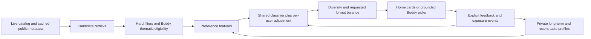

# Adaptive personalised classification and ranking — executed results (notebook 05)

Completed 2026-11-22 through the installed Colab CLI on a CPU runtime, executing the Phase C proposal from [ADAPTIVE_PERSONALIZATION_RESEARCH.md](ADAPTIVE_PERSONALIZATION_RESEARCH.md). [Runnable notebook](05_adaptive_personalization.ipynb) (SHA256 `3dd1aad4e0ec158d030e456ec6c0611ac5da12c7b3eb49f0b8933b43fb84ea1c`), [executed notebook with outputs](05_adaptive_personalization_output.ipynb), [full report](results/adaptive/report.json), [provenance](results/adaptive/provenance.json), [environment freeze](results/adaptive/environment.txt), [notebook execution log](results/adaptive/colab-execution.log), [staged training log](results/adaptive/staged-run.log) and [artifact ZIP](../../artifacts/adaptive-results.zip) (extracted at `ml/artifacts/adaptive-remote/`) sit alongside this document. This extends the [Amazon experiment](TRAINING_RESULTS.md) and the [Kaggle metadata experiment](KAGGLE_TRAINING_RESULTS.md) with the same deterministic 1/128 user sample, so cohorts are directly comparable; it does not replace or retrospectively improve those heldout tests.

## Name and Classification of model

| Field | Value |
|---|---|
| Name | **Distran APC-1** (Adaptive Preference Classifier) |
| Model ID | `distran-apc-v1` |
| Task | Binary preference classification (`rating >= 4` vs `<= 3`) plus ranking of candidate works (NDCG/Recall@10), with log loss, Brier score and a 10-bin reliability table |
| Family | Feature-based linear classifier: shared logistic prior `theta` + private per-user residual `delta_u` in `p(u,i,c) = sigmoid(b + b_u + (theta + delta_u) . x(u,i,c))`. Feature/score fusion — **not** parameter averaging across the SVD/Ridge/BPR artifacts, and not a collaborative matrix-factorisation model |
| Encoders demonstrated alongside | **TextCNN** (1-D convolutions over 24-d token embeddings, filter sizes 3/4/5 × 16 filters, ReLU, max-over-time pooling, 3-class aggregate-score-bucket head; 196,851 params) and a **mini-GPT** (decoder-only causal transformer, d=48, 2 heads, 2 pre-LN blocks, ff=96, next-token LM; 808,128 params), both implemented and trained in pure NumPy with Adam; TF-IDF + truncated SVD (64-d) as the existing baseline |
| Training paradigm | Shared prior by batched SGD with 5 sampled unobserved negatives per user; per-user residual by online SGD under **chronological predict-before-learn replay**; hyperparameters (`lr_u`, `reg_u`) selected on validation log loss; test evaluated once |
| Feature schema | 13 bounded features: item popularity percentile, item mean quality, item domain one-hots, item recency (90-day half-life), user activity, user positive rate, user game/screen affinity, user recency (30-day half-life), two affinity×domain interactions, BPR collaborative percentile |
| Serving | Local JSON coefficients per account (`adaptive-coefficients.json`); no hosted GPU service; nothing promoted to the app |
| Status | Research only. Raw Amazon IDs stayed in memory; exported residuals are keyed by salted hashes |

## Outcome

On the sampled Amazon 5-core interactions (65,999 events; 39,600 train / 13,204 validation / 13,195 test; 4,718 users; 24,390 items), the adaptive model **improves pointwise preference prediction over the shared prior** (test log loss 1.746 vs 2.729; Brier 0.521 vs 0.709) but shows **no measurable ranking gain** over the shared logistic model on this sample (NDCG@10 identical to 3 decimals; bootstrap CIs overlap everywhere), and popularity still edges both on the small game cohort (0.0161 vs 0.0120). Retrieval is dominated by cold items: 8,718 of the heldout positives are items absent from the train catalog, and 849 relevant users have no train events. The neural encoders behave as expected for their tasks: the mini-GPT cuts validation perplexity from 2,047 (unigram) to 34.7, while the TextCNN does **not** beat the majority-class baseline on aggregate score buckets (0.536 vs 0.598 accuracy) — aggregate scores are only weakly predictable from text. These are single fixed-split measurements without cross-model significance claims; they do **not** establish personalized recommendation quality in the app, future rating forecasting, or promotion of any artifact.

### Content encoders (Kaggle metadata corpus, 20,000 docs; 11,202 with usable aggregate scores)

| Encoder | Task | Metric | Baseline | Params |
|---|---|---|---|---:|
| TextCNN | 3-class score bucket (title-group hash split) | test accuracy **0.5358**, macro-F1 **0.3863** | majority **0.5976** | 196,851 |
| mini-GPT | causal next-token LM, 48-token windows, 1,200 steps | val perplexity **34.68** | unigram **2,047.34** | 808,128 |
| TF-IDF+SVD (baseline) | unsupervised 64-d embeddings | explained variance 0.0695 | — | vocab 20,000 |

Encoder geometries differ: mean cosine between CNN and GPT corpus embeddings is 0.007, and top-3 neighbor Jaccard on the 12 curated works ranges 0.10–0.44 (highest between the two SVD variants, 0.44). Example probes (top-3 neighbors among the 12 curated works): `cyberpunk` → CNN `blade-runner, exit-8, arrival`; GPT `disco-elysium, elden-ring, edgerunners`; SVD `disco-elysium, edgerunners, elden-ring`; app SVD v2 `edgerunners, disco-elysium, elden-ring`. The GPT and SVD probes agree more with each other than either does with the CNN on these works. Probe cosine is a transductive diagnostic, not relevance accuracy.

### Adaptive preference classifier (Amazon 5-core sample, chronological split)

Test NDCG@10 / Recall@10 (k=10, full train catalog as candidates, all training interactions excluded; evaluated users / cold-item positives / cold users in the report):

| Model | all | game | screen | game→screen | screen→game |
|---|---|---|---|---|---|
| popularity | 0.0000 / 0.0000 | 0.0161 / 0.0208 | 0.0000 / 0.0000 | 0.0000 / 0.0000 | 0.0000 / 0.0000 |
| bpr | 0.0000 / 0.0000 | 0.0000 / 0.0000 | 0.0000 / 0.0000 | 0.0000 / 0.0000 | 0.0000 / 0.0000 |
| fixed linear (hand-set heuristic weights) | 0.0000 / 0.0000 | 0.0000 / 0.0000 | 0.0000 / 0.0000 | 0.0000 / 0.0000 | 0.0000 / 0.0000 |
| shared logistic (trained `theta`, no per-user residual) | 0.0010 / 0.0033 | 0.0120 / 0.0417 | 0.0000 / 0.0000 | 0.0000 / 0.0000 | 0.0000 / 0.0000 |
| **adaptive (shared + per-user `delta_u`)** | 0.0010 / 0.0033 | 0.0120 / 0.0417 | 0.0000 / 0.0000 | 0.0000 / 0.0000 | 0.0000 / 0.0000 |

Cohort sizes: all 303 evaluated users (8,718 cold-item positives, 849 cold users), game 24 (1,423 / 193), screen 282 (7,295 / 669), game→screen 17, screen→game 7. Validation ranking for the selected adaptive point: NDCG@10 0.0128 all, 0.0015 game, 0.0133 screen. Catalog coverage is 0.0005–0.0828 depending on model/cohort — top-10 lists over a 24k catalog cover almost nothing, as in notebook 03.

Pointwise on the 13,195 test events (predict-before-learn replay):

| Model | Log loss | Brier |
|---|---:|---:|
| shared logistic only | 2.7292 | 0.7093 |
| **adaptive** | **1.7458** | **0.5212** |

Validation selected `lr_u=0.1, reg_u=0.0` from the grid `lr_u ∈ {0.05, 0.1} × reg_u ∈ {0, 0.01}` by validation log loss (1.6286 at the selected point; val NDCG@10 0.0128). The learned shared prior `theta` = [2.456, 0.580, −3.876, −2.972, 0.511, 2.765, 1.111, −2.958, −1.914, −0.317, 3.200, 0.292, 4.653] over the 13 features, intercept −3.518: collaborative percentile and popularity carry the largest positive weights; the domain one-hots are negative (domain enters mainly through the affinity interactions, +3.200 game, +0.292 screen). The 10-bin reliability table shows monotone ranking but over-confident low bins (observed positive rate 0.72–0.94 in every bin) — a base-rate shift between the train and test periods, so these probabilities must not be read as "80% chance you will love this".

## Recommendation

The Phase A design is confirmed as the right first implementation, with one amendment the measurements support: keep the small regularised online logistic model with shared prior and per-user residual as the preference head, because the per-user residual clearly improved pointwise fit (log loss 1.75 vs 2.73) at negligible complexity, while ranking gains were not measurable on this sample. Do not promote any artifact yet: popularity and the shared prior remain competitive rankers on this data, and the app's current fixed-weight ranker is the rollback. Keep live catalog discovery, factual constraints and conversation as separate responsibilities. Add collaborative signals and contextual-bandit exploration only after interaction data and evaluation support them.

The SVD encoder, Ridge regressors, BPR factors and hosted OpenRouter models have different feature spaces, training targets and parameter shapes; their useful combination is **feature/score fusion**, not averaging parameter files. The CNN/GPT encoders trained here are benchmark content encoders: they are not drop-in replacements for the serving SVD (probe agreement with it is 0.10–0.32 Jaccard), and the TextCNN's score-bucket head does not beat majority on this corpus.

## What exists in this repository

| Component | Evidence | Recommended use |
|---|---|---|
| Shared content encoder | Kaggle TF-IDF/SVD trained on 32,952 metadata documents; v3 serving artifacts use canonical provider IDs; notebook 05 adds TextCNN/mini-GPT benchmarks on a 20,000-doc corpus | Reuse SVD as the serving semantic extractor; treat CNN/GPT as offline benchmarks until they beat it on a relevance study |
| Home taste profile | `recommendations.ts` fixed channel weights + MMR | Replace fixed weights with the evaluated adaptive layer only after an app-side relevance evaluation |
| Buddy discovery/classifier/conversation | Live TMDB/IGDB discovery, Decider judgments, Nemotron explanations | Unchanged; Buddy's thematic score is request-relevance evidence, not a personal preference probability |
| Three metadata regressors | Heldout aggregate-score results (notebook 04) | Offline baselines only; aggregate-score prediction is not personal taste |
| Amazon BPR | Validation selected collaborative weight **0.0** in notebook 03; this run reproduces near-zero BPR ranking on test | Keep disabled in the app |
| **Adaptive classifier (new)** | Notebook 05: `distran-apc-v1`, coefficients + residuals in `ml/artifacts/adaptive-remote/adaptive-coefficients.json`, report in [results/adaptive/report.json](results/adaptive/report.json) | Research artifact; the measured pointwise gain justifies a Phase A prototype behind an event ledger, not promotion |

The account store still has no recommendation-impression ledger or logged selection probabilities; `Log.date` is not a dedicated immutable recommendation-event timestamp. This run therefore used the public Amazon sample as a proxy interaction corpus — it does not contain app users.

## Proposed system



Notebook 05 implemented the `D → E` core offline: 13 bounded features per (user, item) event and the shared-plus-residual logistic head. Hard filters, MMR and Buddy eligibility remain deterministic outside the learned layer; learned weights cannot relax them. Home discovers likely interests; Buddy fulfils the current request — the shared classifier can serve both surfaces with distinct labels.

## How the weights change

Two kinds of adaptation, both exercised by the run:

1. **Taste representation:** weighted interests in domains (here game/screen affinity), plus recency-decayed activity (`2^(-age/half_life)`, half-lives 30 days user / 90 days item in the feature schema).
2. **Signal importance:** the shared `theta` over the 13 features (learned on train) plus a small private per-user `delta_u`, initialised at zero and regularised towards zero, so new users inherit the prior.

For a labelled event the online update actually executed is:

```text
delta_u <- clip(delta_u + lr_u * clip_norm((y - p) * x, 1) - lr_u * reg_u * delta_u, -10, 10)
b_u     <- clip(b_u + lr_u * (y - p), -10, 10)        with p = sigmoid(b + b_u + (theta + delta_u) . x)
```

Each event is scored **before** its label is learned (chronological replay), update norms are clipped at 1 and weights at ±10, so a replayed save or one extreme event cannot move the whole profile. Selected `lr_u=0.1, reg_u=0.0` on validation log loss. Long-term and recent profiles, edited/deleted feedback replay, and feature-schema migrations remain as designed in the research doc; an encoder change still requires a compatible migration — coefficients from one feature space cannot be silently reused in another. The exported JSON (`per_user_residuals`, 1,000 users with ≥10 train events, salted keys) implements exactly this update rule for a future TypeScript parity check.

## Labels and events we need

The run used the versioned threshold policy `rating >= 4 → positive, rating <= 3 → negative`; unobserved items were used only as sampled negatives for the shared prior (5 per user), never as proven dislikes. The app-side observation table from the research doc still stands:

| Observation | Initial handling |
|---|---|
| Explicit "more/less like this" | Positive/negative taste feedback with optional reason |
| High/low rating | Taste evidence under the explicit versioned threshold; neutral stays unknown |
| Favourite | Positive taste evidence; exclude seeded/demo favourites from training |
| Creator follow | Creator-interest evidence; distinguish from starter defaults |
| Save to a list | Separate intent signal; a saved recommendation is not proof of enjoyment |
| Card click | Weak engagement, not an explicit preference label |
| "Already seen" | Exclusion correction, not dislike |
| Dropped status | Ambiguous without a dislike/reason |
| No click / no rating | Unknown; unshown works are not negatives |
| Buddy preselected cards saved together | Batch intent evidence, not independent positives |

Still required before any training on app data: recommendation ID, pseudonymous account key, event ID/type, surface, real work ID, served rank, shown-at/acted-at timestamps, encoder/policy/feature versions, the served feature snapshot, provenance, the eligible candidate set reference, an explicit impression definition, and the **actual logged selection probability** where choices are randomised.

## Approaches considered

| Approach | Strength | Measured here | Decision for Distran |
|---|---|---|---|
| Online logistic, shared prior + per-user residual | Small, updateable from explicit feedback, JSON-servable | Pointwise log loss 1.746 vs 2.729 shared-only; ranking NDCG unchanged | **Recommended first implementation (Phase A)** |
| Popularity / BPR collaborative / fixed heuristic | Strong rankers on this sample | NDCG@10 game 0.0161 (popularity) vs 0.0120 (adaptive); BPR 0.0000 | Keep as baselines/rollback; BPR stays disabled |
| TextCNN content encoder | Conv features over text; supervised head | Does not beat majority on score buckets (0.536 vs 0.598) | Benchmark only |
| Mini-GPT content encoder | Real LM pretraining; useful text geometry | Val perplexity 34.7 vs 2,047 unigram | Benchmark only; not a serving encoder yet |
| TF-IDF+SVD (existing) | Cheap, already serving | Probe Jaccard with GPT 0.23, with CNN 0.10 | Keep as serving encoder |
| LightFM hybrid factorisation | Metadata + collaborative factors | Not run (no canonical app interaction mapping) | Evaluate after interaction coverage exists |
| CatBoost learning-to-rank | Nonlinear interactions, grouped ranking | Not run (insufficient grouped app data) | Compare offline later |
| Two-tower / multi-task neural recommender | Shared retrieval/preference representations | Not run at this scale | Later experiment |
| Contextual bandit (LinUCB etc.) | Learns an exploration policy | Not possible: no exposure log or propensities | Defer |
| Parameter averaging across artifacts | — | Incompatible architectures; rejected by design | Feature/score fusion instead |

## Bandits and evaluation

Updating weights after ratings is not a bandit; a bandit also chooses what to expose. No impression ledger or logged propensities exist, so no off-policy/bandit evaluation was possible — this run reports only standard metrics. Evaluation protocol actually followed: global chronological cutoffs (60%/80% of distinct timestamps) for interactions; title-group hash splits (buckets 0–5/6–7/8–9 of SHA256(normalized title) mod 10) for the corpus; train-only feature statistics and train-only vocabulary/IDF/BPR; hyperparameters selected on validation; test scored once; per-user bootstrap CIs (400 resamples) reported in the JSON. Measured: NDCG/Recall@10 per cohort, log loss, Brier, 10-bin reliability, catalog coverage, cold-user/cold-item counts. Not established: calibration (the reliability table shows a train→test base-rate shift), cross-model significance, coverage beyond top-10, latency, and any app-surface quality. A rating-prediction or log-loss gain is not a recommendation-quality gain.

## Integration, training and hosting

**What was executed (Phase C, done):** `ml/adaptive_experiment.py` embedded in notebook 05, run on a Colab CPU runtime through the installed CLI. Because a single CLI call in this environment is time-bounded, the experiment is staged and checkpointed (`cache/checkpoint.json` + `cache/ctx.pkl` on the runtime); each stage (downloads → parse → corpus → CNN → GPT → SVD/probes → BPR stats → shared prior → validation grid → test → export) resumes on the next call, and the final notebook execution completed all four cells with every stage cached. Pinned NumPy 2.2.6, pandas 2.2.3, scikit-learn 1.6.1, kagglehub 0.4.3; training ran in a fresh Python subprocess so cached imports cannot bypass the pins. Runtime of the final measured pass: 187 s of compute on the CPU runtime (plus download/parse stages).

**Phase A (next, app-side):** event/feedback schema with provenance flags; extract the 13-feature schema; local positive/negative/domain profiles; benchmark the adaptive classifier against fixed weights on app events with chronological boundaries and matured feedback windows. No new hosted GPU service is needed for small-vector scoring.

**Phase B:** Buddy two-step flow (server returns up to 30 eligible candidates with public relevance features; client personalises locally; server explains the exact selection). **Phase C (this run):** shared model trained and measured on the public proxy corpus; promotion still gated on measured improvement. **Phase D:** logged exploration slot only after stable outcomes exist.

Hosting: reuse the existing FastAPI/catalog cache and on-device storage; persist a versioned small coefficient vector per account (JSON initially, SQLite ledger later). Colab is an experiment environment, not the serving backend. Cross-device learning still requires real authentication, consented pseudonymised event upload and a shared event store — none exist in the local preview.

## Sources, cleaning and leakage controls

| Source | Consumed file | Rows | SHA256 (first 16) |
|---|---|---:|---|
| Amazon 5-core `Video_Games` (rating only) | `Video_Games.csv.gz` | 814,586 (6,676 sampled) | `a2bde5f3b945960d` |
| Amazon 5-core `Movies_and_TV` (rating only) | `Movies_and_TV.csv.gz` | 7,441,129 (59,323 sampled) | `260d72b08d5e5012` |
| TMDB popular movies v2 | `movies_tmdb_popular.csv` | 10,000 | `bc97c7426389cb65` |
| HowLongToBeat snapshot v1 | `hltb_data.csv` | 147,474 (10,000 sampled) | `63832555c3b5861b` |

- Amazon: complete-file scans; deterministic 1/128 user sample by SHA256(source user id) — identical cohort to notebook 03; per-run random salt pseudonymises users (salt not exported); duplicate (user, item, timestamp) events removed (0 observed); ratings validated to [1,5]; chronological 60/80 split by timestamp.
- Corpus: TMDB rows need title; score = `vote_average` with `vote_count >= 5`; HLTB deduplicated to one row per `game_game_id`, deterministic SHA256-title-ordered 10,000-row sample; score = `game_review_score/10` with `game_count_review >= 5`; buckets low < 6, mid 6–7.5, high > 7.5. Text = title + overview/synopsis (+ language, genres, developer, publisher for HLTB). Title-group hash split keeps a title's docs on one side.
- Classifier features are computed from train only; vocabulary, SVD, BPR and the shared prior are fit on train only; cold validation/test items get a neutral vector (zero popularity, global mean quality, domain one-hots, median collaborative percentile) and cold users are excluded from ranking but counted; heldout positives on cold items are counted, never treated as retrievable. Amazon item IDs have no reviewed mapping to the app catalog, so the CNN/GPT semantic channels are benchmarked on the corpus and the 12 curated works, not used as features inside the Amazon replay. The corpus is a retrospective snapshot with selection bias.

## Reproduction

```sh
colab new -s distran-adaptive-20261122
colab exec -s distran-adaptive-20261122 -f ml/notebooks/05_adaptive_personalization.ipynb --timeout 3600
colab download -s distran-adaptive-20261122 /content/distran-adaptive/results.zip ml/artifacts/adaptive-results.zip
# Extract into ml/artifacts/adaptive-remote and review report.json before any use.
colab stop -s distran-adaptive-20261122
```

The notebook embeds the full experiment source (`ml/adaptive_experiment.py`, SHA256 `2fc608a56a486b74fe49d4cb4b26ba569894cab7b39186c542475d550229cdbe`), `distran_ml/baseline.py`, the curated catalog snapshot and the v2 app vectors, so it needs no checkout. Stages checkpoint under `/content/distran-adaptive/cache/`, so interrupted runs resume; a module-version gate invalidates stale checkpoints. Edit `ml/adaptive_experiment.py` for future runs and regenerate the notebook embed; do not silently alter an already measured notebook. Local checks: `ml/artifacts/test-env/bin/python -m unittest discover -s ml/tests -v` (16 tests, including 6 new adaptive tests covering cold items/users, predict-before-learn replay, calibration bin coverage, shared-prior learning and the tokenizer). The CNN and mini-GPT backward passes were additionally verified against numerical gradients (max relative error < 1e-3 on sampled coordinates) before the remote run.

## Verification

- All four notebook code cells completed with saved outputs via CLI 0.7.5 (execution counters stay null; the execution log records each cell). The final measured pass reported 187 s compute; full staged wall time including downloads is recorded in the session log.
- Pinned environment verified from the training subprocess: Python 3.13.18, NumPy 2.2.6 (freeze in [environment.txt](results/adaptive/environment.txt)).
- 16 ML unit tests pass in the isolated local environment (10 pre-existing + 6 new for the adaptive module).
- Input SHA256 values (Amazon files, Kaggle files, catalog snapshot, experiment source, notebook) are preserved in [provenance.json](results/adaptive/provenance.json) and [report.json](results/adaptive/report.json).
- Artifacts downloaded before the runtime was released: coefficients (1,000 salted per-user residuals), encoder weights (`encoders.npz`), tokenizer, catalog probes, report, provenance, environment freeze. No hosted service, native bundle or Buddy chat was deployed; nothing was promoted to the app.
